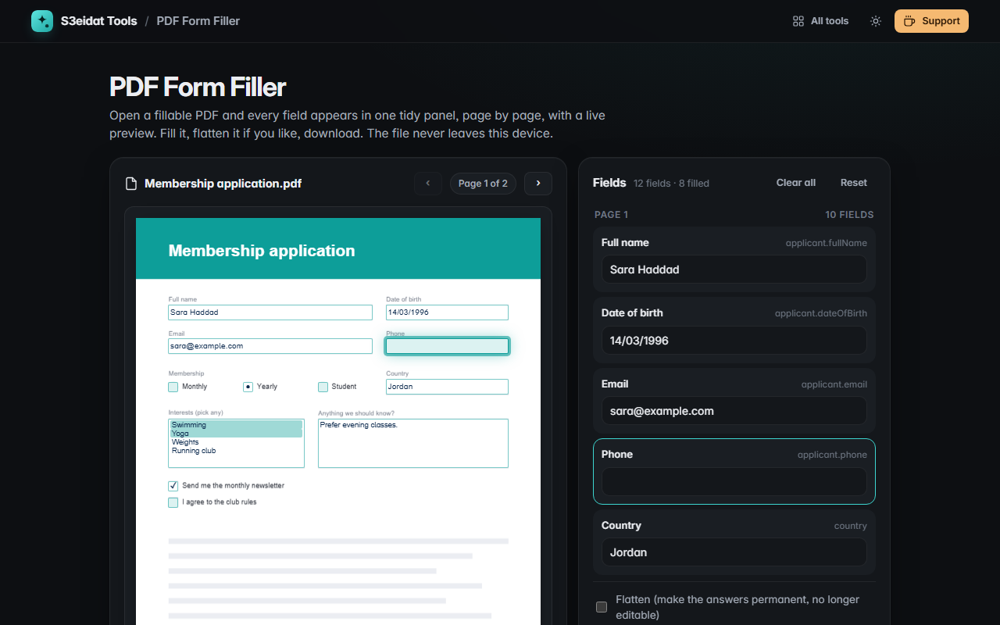

# PDF Form Filler

> Fill in PDF forms in your browser. Every field in one panel, a live page preview, optional flattening. Free, private, and it runs entirely in your browser.

### ▶ [Open PDF Form Filler](https://s3eidat.github.io/pdf-fill/)



## Features

- Lists **every form field**: text, multi-line text, checkboxes, radio groups, dropdowns (including editable ones) and option lists (including multi-select)
- Fields are **grouped by page** and listed in reading order, with their tooltips as labels, required marks and read-only fields shown as such
- **Live page preview**: fields are highlighted on the page and show your answers as you type; click a box to jump to its field
- **Clear all** or **reset** to the values the file came with
- **Flatten** (optional) bakes the answers into the page so they can't be changed
- Fields you didn't touch keep the file's own appearance
- If the PDF has **no form fields**, it says so and points you to [PDF Sign](https://s3eidat.github.io/pdf-sign/) for typing on flat PDFs

## Limits

- Answers are drawn with the standard PDF font (Helvetica). Text it can't draw, such as **Arabic**, is still saved in the field and the PDF asks the viewer to draw it (Acrobat, Chrome and most viewers do), but such fields **can't be flattened** here.
- XFA (LiveCycle) forms: the XFA layer is removed on download so the standard fields you filled are what viewers show.
- Password-protected PDFs need their protection removed first.

## Privacy

Your PDF and your answers never leave your device. There is no server, no account, no analytics.
The page ships with a strict Content-Security-Policy (`connect-src 'self'`), so the browser
itself blocks any attempt to send data anywhere. Forms are filled with [pdf-lib](https://github.com/Hopding/pdf-lib) (MIT)
and previewed with [pdf.js](https://github.com/mozilla/pdf.js) (Apache-2.0), both included in `lib/`.

## Run it yourself

It's plain HTML, CSS and JavaScript with no build step:

```bash
git clone https://github.com/s3eidat/pdf-fill
cd pdf-fill
python -m http.server 8000
```

Then open http://localhost:8000.

## Support

If this saved you time, **[buy me a coffee ☕](https://s3eidat.github.io/coffee/)**. It keeps every tool free.

---

Part of **[S3eidat Tools](https://s3eidat.github.io/)**: 100+ free, private tools that run in your browser. MIT licensed.
